# Hi 👋, I'm Girish Parate

<h3 align="center">Mobile App Developer | React Native | Flutter | SwiftUI</h3>

  
  

- 🔭 Currently working on [Unsplash App (iOS)](https://github.com/girish54321/UnSplash-iOS)
- 🌱 Currently learning **Flutter, Swift & SwiftUI**
- 👯 Looking to collaborate on **Mobile App Development**
- 🤝 Looking for help with **Swift & Flutter (Riverpod)**
- 💬 Ask me about **React Native & Flutter**

---

### Connect with me

  
  
  

---

### Languages and Tools

  

---

### GitHub Statistics

  

  

